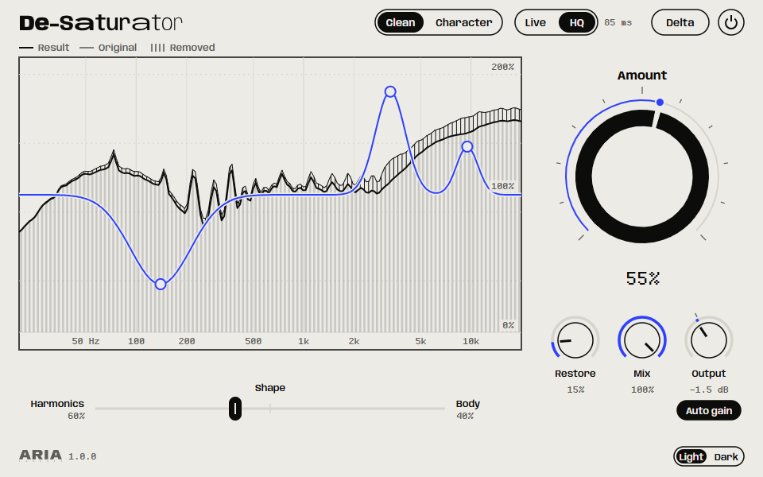

# De-Saturator: design 1.2.0

The design for De-Saturator, a free plugin that thins a sound, and its brand, a sub-brand of Aria Ashrafi. Direction **B, Hairline**: thinner, drawn literally. What stays is heavy and what's removed is a hairline, in the analyser, in the Amount ring and in the name.

## Start here

1. **`prototype/prototype.html`**: open it in a browser. It is the window, working: knobs, the curve, every switch, tooltips, the sizes. The analyser runs on a stand-in signal; nothing plays.
2. **`spec/SPEC.md`**: the build spec, written out: window, colours, type, strokes, every element's position and size, every state, interaction, strings, parameters, accessibility, and what the window needs from the processor.
3. **`spec/spec.json`**: the same spec for code.
4. **`states/`**: every state as PNG at 1x and 2x, and `redlines.png` with every position and size. `states/states.json` lists them.

## What to embed

| File | What it's for |
|---|---|
| `fonts/Anybody-SemiBold-600.ttf` | Labels, switches, Delta, Auto gain |
| `fonts/Anybody-Bold-700.ttf` | The Amount title |
| `fonts/Anybody-Medium-500.ttf` | Tooltips |
| `fonts/DepartureMono-Regular.otf` | Every value and readout |
| `ui/assets/wordmark-header.svg`, `-dark.svg` | The name in the header (a drawing, not text), light and dark |
| `ui/assets/credit.svg`, `credit-dark.svg` | The Aria Ashrafi credit, light and dark |

Both fonts are under the SIL Open Font License 1.1: ship `fonts/Anybody-OFL.txt` and `fonts/DepartureMono-OFL.txt` with the plugin.

## The numbers that matter most

- Window 960 × 600, scales 75% to 200% at 16:10. All coordinates in the spec are at 100%.
- Analyser: 20 Hz to 20 kHz log, −90 to +6 dB, 4.5 dB/oct tilt around 1 kHz. The result is measured **after Mix, before Output and Auto gain**, so the gap only ever shows thinning.
- Thinning curve: bells on a 100% baseline, up to six, 0 to 200%. In Live, draw the curve you drew (dashed) and the applied curve from the processor (solid).
- Colour: paper, ink (in every weight, for the sound), graphite deep (values), and klein for everything you set. A dark theme swaps each role (Light / Dark at the bottom right; a preference kept with the plugin's state, not a parameter).
- No keyboard: the window takes no keys and never takes keyboard focus.

## Release

`installers/` holds ICON_BIG, the Windows .ico, the VST3 bundle's PlugIn.ico, desktop.ini and snapshots, the Inno Setup wizard images and the macOS .icns, .pkg and disk image backgrounds. `installers/README.md` says where each one goes. `favicons/` and `store/` are for the product page.

## Also here

- `logo/`: the name, the mark, lockups and icon tiles, SVG and PNG.
- `tokens/`: the same values as DTCG tokens: sizes, strokes and type, and the colours per theme.
- `CHANGELOG.md`: what changed in each version.
- `board-v1/`: the direction board that B was picked from.
- `build/`: the sources. `build/ui/core.js` is the single source for the window: layout, colours, drawing. The prototype, the state pictures and the spec are all made from it, so they agree. Rebuild everything with `bash build/make.sh` (Git Bash; it needs Python with fontTools, Node, and Playwright with Chrome).

It's also in Specimen, as De-Saturator inside Aria Ashrafi: https://specimen.ariaashrafi.com

## Changes

The design is changed here and nowhere else. If the build needs a number or a behaviour to change, ask: the change goes into `core.js`, everything is rebuilt, and `VERSION` goes up.
