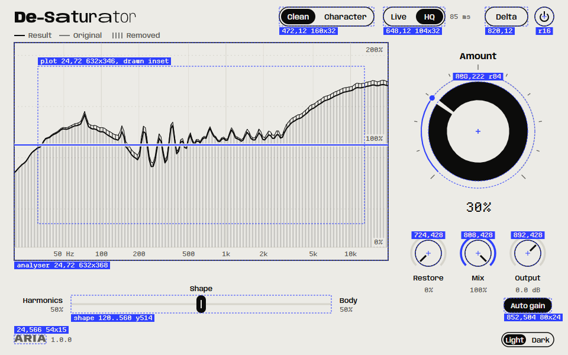

# De-Saturator: window spec 1.2.1

Direction B, Hairline. Thinner, drawn literally. What stays is heavy, what's removed is a hairline: in the analyser, in the Amount ring, in the name.

Everything here comes from `build/ui/core.js`, the same file that draws the prototype and the state pictures, so the two agree; if they ever don't, the picture is right. Machine-readable: `spec/spec.json`. Pictures: `states/`. Try it: `prototype/prototype.html`.

## Window

- 960 × 600 at 100%, aspect 960:600 (1.6), resizable from 75% (720 × 450) to 200% (1920 × 1200) at that ratio. Draw at 100% coordinates under one scale transform.
- Square corners everywhere except pills (switches, Delta, Auto gain, the Shape thumb) and circles. Nothing in between.
- Flat: no gradients, no shadows, no glows. One colour is drawn at an opacity: the analyser's body comb, ink at 16%.
- Hairlines (1 px) never go under one physical pixel at 75%.
- Two themes, light (paper, the default) and dark (ink), switched by Light / Dark at the bottom right. Every colour below is a role with a light and a dark value; the descriptions name the light ones.
- No keyboard. None. The window takes no keys and never takes keyboard focus, so the host keeps all its shortcuts (in JUCE: setWantsKeyboardFocus(false) and setMouseClickGrabsKeyboardFocus(false) on the editor and every control).

Draw order: ground → analyser frame and grid → frequency labels → comb body, removed, original line, result line (clipped to the plot) → curve (underlay, then line) → scale labels → state line → points, brackets, readout → header, legend, Amount, knobs, Auto gain, Shape, credit → tooltip.



## Colour

| Role | Light | Dark | Use |
| --- | --- | --- | --- |
| ground | paper `#ECEBE6` | ink `#0C0C0B` | The window. |
| text | ink `#0C0C0B` | paper `#ECEBE6` | Labels, the name, button outlines, the analyser's frame. |
| textMuted | graphiteDeep `#5F5E59` | graphite `#8A8983` | Values, the latency, frequency labels, the credit. |
| grid | paperLine `#D6D4CB` | inkLine `#2A2A27` | The analyser's grid, knob tracks, the Shape track. |
| body | ink at 16% `#0C0C0B` | paper at 20% `#ECEBE6` | Analyser: the comb under the result line, at 16% opacity. What stays, kept quiet. |
| result | ink `#0C0C0B` | paper `#ECEBE6` | Analyser: the result line, heavy. What you hear. |
| original | ink `#0C0C0B` | paper `#ECEBE6` | Analyser: the original's line, a hairline. |
| removed | ink `#0C0C0B` | paper `#ECEBE6` | Analyser: hairlines between the two lines. What's removed. |
| hand | klein `#2E40FF` | kleinLight `#7C88FF` | What you set: the thinning curve, its points, value arcs, Delta when on. |
| selected | ink `#0C0C0B` | paper `#ECEBE6` | The chosen segment of a switch; Auto gain and Bypass when on. |
| onSelected | paper `#ECEBE6` | ink `#0C0C0B` | Text and icons on ink. |
| onHand | paper `#ECEBE6` | ink `#0C0C0B` | Text on klein. |
| readout | ink `#0C0C0B` | paper `#ECEBE6` | Readout chips and tooltips. |
| onReadout | paper `#ECEBE6` | ink `#0C0C0B` | Text in readout chips and tooltips. |

Contrast (WCAG):

```
pass  16.39:1  ink on paper
pass  5.44:1  graphite deep on paper
pass  5.34:1  klein on paper
pass  5.34:1  paper on klein
pass  16.39:1  paper on ink
decorative  1.24:1  paper line on paper
pass  16.39:1  dark: paper on ink
pass  5.58:1  dark: graphite on ink
pass  6.36:1  dark: klein light on ink
pass  6.36:1  dark: ink on klein light
pass  16.39:1  dark: ink on paper
decorative  1.36:1  dark: ink line on ink
```

## Type

| Role | Font file | Size | Use |
| --- | --- | --- | --- |
| title | `fonts/Anybody-Bold-700.ttf` | 15 px | The Amount title. |
| button | `fonts/Anybody-SemiBold-600.ttf` | 13 px | Switches and the Delta pill. |
| label | `fonts/Anybody-SemiBold-600.ttf` | 12 px | Control labels, Auto gain. |
| tooltip | `fonts/Anybody-Medium-500.ttf` | 12 px / 16 | Tooltips. |
| value | `fonts/DepartureMono-Regular.otf` | 11 px | Values, frequency and scale labels, chips, latency, version. |
| valueLarge | `fonts/DepartureMono-Regular.otf` | 22 px | The Amount value. |

Sentence case everywhere. Departure Mono is a pixel face: it is drawn for 11 and 22 px at 100%. Both families are under the SIL Open Font License 1.1: embed the files and ship `fonts/*-OFL.txt` with the plugin. The name is never set from the font; it is `ui/assets/wordmark-header.svg`.

## Strokes

| Stroke | px | Use |
| --- | --- | --- |
| frame | 1.5 | The analyser's frame. |
| grid | 1 | Grid lines. |
| body | 2.6 | Analyser comb, the part under the result line. |
| result | 2 | The result line. |
| original | 1 | The original's line. Never under 1 physical pixel. |
| hair | 1 | Analyser comb, the part between the two lines (what's removed). Never under 1 physical pixel. |
| removedDelta | 2.6 | Delta: the removed part of the comb, heavy. |
| outline | 1.5 | Switches, pills, Bypass, small knob bodies. |
| outlineHover | 2.5 | The same outline under the pointer. |
| curve | 2 | The thinning curve. |
| curveApplied | 2.25 | Live: the applied (smoothed) curve. |
| curveDrawn | 1.25 | Live: the curve you drew, dashed 4 on, 4 off. |
| curveUnder | 5 | A paper line under the curve so it reads over the analyser. |
| knobTrack | 3.5 | Small knob track and value arc. |
| amountArc | 2 | Amount track and value arc. |
| tick | 1.25 | Amount scale ticks. |
| pointRing | 2 | Curve point ring. |
| bracket | 1.25 | A point's width bracket. |
| ringMax | 44 | Amount ring at 0%: nearly a solid disc. |
| ringMin | 1.5 | Amount ring at 100%: a hairline. |

## Header

- **Name**: An outlined drawing, not text: the weight changes letter by letter. Draw the SVG with its origin at x 24 and its baseline (y 0 in the file) at y 38. Ink in the light theme, paper in the dark one (wordmark-header-dark.svg), in every state.
- **Key** (baseline 64): a short heavy line "Result" at x 24, a hairline "Original" at x 100, four hairlines "Removed" at x 190, labels 24 px right of each swatch, in the label type, graphite deep. In Delta the Removed swatch turns klein.
- **Clean / Character**: x 472, y 12, 160 × 32 (segments 64 + 96). **Live / HQ**: x 648, 104 × 32 (52 + 52). Pill outline, ink 1.5, radius half the height. An inner pill inset 3 px, ink, with paper text. On an unselected segment: a 1 px ink inner outline inset 3.5 px.
- **Latency**: "{ms} ms" from the processor in HQ, "0 ms" in Live. Room for six characters ("120 ms"). Value type, graphite deep, x 760, baseline 32.
- **Delta**: x 820, y 12, 72 × 32. Ink outline 1.5 (2.5 under the pointer), ink text. Klein fill, paper text.
- **Bypass**: a circle radius 16 at (920, 28). Arc radius 7 around (920, 29) from 38° to 322° (0° up, clockwise) and a stem from y 19 to 27, both 2 px with butt caps. Ink fill, paper icon.

## Analyser

Frame x 24, y 72, 632 × 368: paper, ink outline 1.5. The plot is its top 346 px; the 22 px strip under it carries the frequency labels (value type, graphite deep, centred, baseline 433).

- Frequency: 20 Hz to 20 kHz, log. x = 24 + 632 * log2(f / 20) / log2(1000).
- Level: -90 to +6 dB with a 4.5 dB/oct tilt pivoting at 1 kHz. y = 72 + 346 * (6 - dB) / 96.
- Grid: verticals at 50, 100, 200, 500, 1k, 2k, 5k, 10k (100, 1k, 10k full, the rest at 55%); dashed (2/4) level lines at −72, −48, −24 and 0 dB; a line along the plot's bottom. Paper line, 1 px.

**The comb.** 120 vertical lines, x(j) = 24 + (j + 0.5) * 632 / 120, j = 0..119. Each line is sampled at its own frequency and drawn in two parts, with two lines across all the bins over them:

| Layer | From → to | Normal | Delta | Bypassed |
| --- | --- | --- | --- | --- |
| Body | plot bottom + 2 → result | ink at 16%, 2.6 | same | same |
| Removed | result → original | ink 1 | klein 2.6 | hidden |
| Original line | every bin | ink 1 | ink 1 | hidden (equals the result) |
| Result line | every bin | ink 2 | graphite deep 1 | ink 2 |

So the result reads as one heavy line over a quiet grey comb, the original as a fine line above it, and what's removed as the hatched band between them. In Delta the hatching is what you hear, so it turns heavy and klein.

**Scale labels**, right-aligned at x 646: "200%" (baseline 88), "100%" (238), "0%" (413), each on paper at 85%.

**State line**, top left of the plot (text x 39, baseline 93.5, on paper at 90%): one of "Bypassed", "Delta: you hear only what's removed", "Live: the applied curve is smoothed", "Six points is the most". Priority: Bypassed, then Delta, then a passing note, then Live.

## Thinning curve

- value(f) = clamp(1 + sum over points of (a - 1) * exp(-0.5 * (log2(f / f0) / (w / 2.3548))^2), 0, 2). w is the bell's width in octaves at half height.
- y = 72 + 346 * (1 - value / 2): 200% at the top, 100% (follows Amount) in the middle, 0% (untouched) at the bottom.
- Up to 6 points. Frequency 20 Hz to 20 kHz, amount 0 to 200%, width 0.3 to 4 octaves (new points 1).
- **HQ**: one line, klein 2, over a paper underlay 5.
- **Live**: the curve you drew dashed (klein 1.25, 4 on 4 off) and the applied curve from the processor solid (klein 2.25, paper underlay 5).
- **Bypassed**: curve and points at 45%.
- **Points**: A point sits at (its frequency, its amount), not on the summed curve. Paper fill, klein ring 2, radius 6.5. Hover: Radius 8.5, plus the width bracket and the readout. Selected: Klein fill radius 7 with a 2 px paper ring, a klein halo ring radius 12 (1.25), the width bracket and the readout. Stays after release. Dragging: As selected, plus a dashed klein drop line (1 px, 2/3) from 12 px under the point to the plot bottom. Bracket: At the point's height, from f * 2^(-w/2) to f * 2^(w/2), klein 1.25, with 10 px end ticks.
- **Readout**: an ink chip 19 high, paper text, "{freq}  {amount}%  {width} oct", two spaces apart. freq: "140 Hz", "3.3 kHz", "12 kHz". width to one decimal. 39 px above the point (22 below when it's within 46 px of the top), kept 6 px inside the plot.

## Amount

Centre (808, 222). angle = -135° + 270° * amount / 100 (0° up, clockwise).

- **The ring** thins as Amount rises: outer radius 84, width w = 44 - 42.5 * amount / 100 (a near-solid disc at 0%, a hairline at 100%), centred on radius 84 - w / 2. A 6 px gap (arc length at the centre radius) centred on the angle. Ink.
- Arc radius 96, -135° to 135°, paper line 2. Arc radius 96 from -135° to the angle, klein 2.
- A klein dot radius 5.5 (7.5 while dragging) with a 2 px paper ring, on radius 96 at the angle.
- 11 ticks every 27° from radius 104 to 109; 113 at 0%, 50% and 100%. graphite deep 1.25; ink under the pointer.
- "Amount" in the title type, centred, baseline 100. The value (22 px mono) centred at baseline 358; under the pointer or while dragging it sits on an ink chip 80 × 32 at y 334, paper text.
- Bypassed: Ring, value arc and dot in graphite deep.

## Restore, Mix, Output

Centres at x 724, 808, 892, y 428. Paper fill, ink outline 1.5 (2.5 under the pointer or while dragging). Arc radius 29, -135° to 135°, paper line 3.5. Klein 3.5 from -135° (Output: from 0 dB, at -27°) to the angle. Graphite deep when bypassed. Output only: a tick at 0 dB (-27°) from radius 33 to 38, graphite deep 1.25, ink under the pointer or while dragging, so unity can be found on a 60 dB knob. Ink 3, square caps, from radius 7 to 18 at the angle. Label baseline 474; value baseline 493.5, graphite deep. On an ink chip 17 high, paper text.

**Auto gain** under Output: a pill at x 852, y 504, 80 × 24. Ink fill, paper text. Ink outline 1.5 (2.5 under the pointer), ink text.

## Shape

Paper line 3 from x 120 to 560, with a 12 px centre tick (1.5). Ink pill 16 × 30 centred on x = 120 + 440 * shape / 100, with a 14 px paper mark (2). An ink outline 1.5 around the thumb, 4 px out. "Harmonics" right-aligned at x 106, baseline 512, its share (100 - shape)% under it at 527; "Body" at x 574, its share shape% under it. "Shape" centred at x 340, baseline 492.

## Footer

**Credit**: `ui/assets/credit.svg` (dark: `credit-dark.svg`) drawn 54 × 15 at (24, 566); the plugin's own version string ("1.0.0" in the pictures) in the value type, graphite deep, at x 86, baseline 578.

**Theme**: Light / Dark at x 848, y 562, 88 × 24 (44 + 44). A small switch like Clean / Character, 24 high, label type. A window preference, not a parameter: keep it in the plugin's state, and start new instances with the theme last chosen.

## Interaction

- **Drag**: knobs vertically, 240 screen px for the whole range, 1200 with Shift. Shape horizontally, the thumb follows the pointer.
- **Double-click knob**: reset to default.
- **Double-click shape**: reset to default.
- **Double-click empty analyser**: add a point at the pointer (width 1 oct); with six already, show "Six points is the most" for 2 s.
- **Double-click point**: remove it.
- **Wheel**: on a knob one step per notch (1%, Output 0.5 dB); on a point width ±0.1 oct per notch, 0.3 to 4. Only once the window has been clicked, so a host's scroll isn't stolen.
- **Points**: Press selects and drags it: frequency follows x, amount follows y. Clicking empty analyser deselects. Hit radius 13 px.
- **Keyboard**: None. The window takes no keys and never takes keyboard focus, so the host keeps all its shortcuts (in JUCE: setWantsKeyboardFocus(false) and setMouseClickGrabsKeyboardFocus(false) on the editor and every control).
- **Tooltips** after 600 ms: 8 px under the control (above when it would leave the window), centred, kept 8 px inside. On the analyser: 18 px under the pointer. On press, on leaving the control, and while dragging. Ink box, paper text, Anybody Medium 12/16, padding 10 × 8, at most 220 wide.

| Over | Tooltip |
| --- | --- |
| amount | How much thinner. The curve scales it at each frequency. |
| shape | Harmonics takes out overtones. Body takes out weight. |
| restore | Undoes soft clipping. Clean only undoes what it finds. Character goes further, lifting attacks. |
| mix | How much of the thinned sound you hear against the original. |
| output | The level after everything else. |
| autoGain | Keeps the level steady, so thinner doesn't just mean quieter. |
| delta | Hear only what's being removed. |
| character:clean | Clean: transparent, for fixing. |
| character:character | Character: goes further, for effect. |
| quality:live | Live: no latency. The curve is applied smoothed. |
| quality:hq | HQ: full resolution. Adds latency. |
| bypass | Hear the track untouched. |
| theme:light | A paper window. |
| theme:dark | An ink window, for a dark room. |
| display | Double-click to add a point, up to six. |
| point | Drag to move. Scroll to change its width. Double-click to remove. |

- **Motion**: Nothing eases. Values, hovers and switches change on the next frame; the analyser runs at 30 to 60 fps. The only timers are the tooltip delay (600 ms) and the six-points note (2 s).

## Parameters

| ID | Name | Range | Default | Shown as |
| --- | --- | --- | --- | --- |
| `amount` | Amount | 0 to 100 % | 30 | whole percent: "30%" |
| `shape` | Shape | 0 to 100 % | 50 | whole percent: "30%" |
| `restore` | Restore | 0 to 100 % | 0 | whole percent: "30%" |
| `mix` | Mix | 0 to 100 % | 100 | whole percent: "30%" |
| `output` | Output | -24 to 36 dB | 0 | one decimal, a sign, "dB": "−1.5 dB", "0.0 dB", "+3.0 dB"; the widest are "−24.0 dB" and "+36.0 dB", 8 characters |
| `autoGain` | Auto gain | on / off | true | pill or button state |
| `delta` | Delta | on / off | false | pill or button state |
| `character` | Character | clean / character | clean | Clean / Character |
| `quality` | Quality | live / hq | hq | Live / HQ |
| `bypass` | Bypass | on / off | false | pill or button state |

## What the window needs from the processor

- The input spectrum, and the result spectrum after thinning and Mix but before Output and Auto gain, in dB on the same bins. The gap between them is all the analyser shows, so a level change never looks like thinning.
- The effective thinning curve as values 0 to 2 on a log frequency axis, 20 Hz to 20 kHz, in both modes. In HQ it equals the drawn curve.
- The latency in ms, for the label beside Live / HQ.
- Display ballistics the stand-in uses: rise at once, fall 28 dB per second, a 1-2-1 smoothing across neighbouring bins, the 4.5 dB/oct tilt pivoting at 1 kHz, at 30 to 60 frames a second.

## Accessibility

| Control | Role | Value | Help |
| --- | --- | --- | --- |
| Amount | slider | the readout text | How much thinner. The curve scales it at each frequency. |
| Shape | slider | the readout text | Harmonics takes out overtones. Body takes out weight. |
| Restore | slider | the readout text | Undoes soft clipping. Clean only undoes what it finds. Character goes further, lifting attacks. |
| Mix | slider | the readout text | How much of the thinned sound you hear against the original. |
| Output | slider | the readout text | The level after everything else. |
| Auto gain | toggle button | on / off | Keeps the level steady, so thinner doesn't just mean quieter. |
| Delta | toggle button | on / off | Hear only what's being removed. |
| Character | radio group | Clean or Character | Clean: transparent, for fixing. |
| Quality | radio group | Live or HQ | Live: no latency. The curve is applied smoothed. |
| Bypass | toggle button | on / off | Hear the track untouched. |
| Thinning curve | group | "{n} points" | Double-click to add a point, up to six. |
| Curve point | slider (2D) | the readout text | Drag to move. Scroll to change its width. Double-click to remove. |
| Theme | radio group | Light or Dark | An ink window, for a dark room. |

## States

Every state is in `states/` at 1x and 2x (`@2x`).

| State | What changes | Picture |
| --- | --- | --- |
| Default | As it opens: Amount 30%, no points, the curve flat at 100% (it follows Amount everywhere). | [1x](../states/default.png), [2x](../states/default@2x.png) |
| In use | Amount 55%, three points: less in the lows, more around 3 kHz and 9.5 kHz. | [1x](../states/in-use.png), [2x](../states/in-use@2x.png) |
| Amount, hover | The ticks darken and the value turns into a chip. | [1x](../states/amount-hover.png), [2x](../states/amount-hover@2x.png) |
| Amount, drag | The pointer dot grows while you drag. The ring thins as the value rises. | [1x](../states/amount-drag.png), [2x](../states/amount-drag@2x.png) |
| Small knob, hover | The outline thickens and the value turns into a chip. | [1x](../states/knob-hover.png), [2x](../states/knob-hover@2x.png) |
| Small knob, drag | Restore being dragged. | [1x](../states/knob-drag.png), [2x](../states/knob-drag@2x.png) |
| Output at +36 dB | Output dragged to the top: the widest value, and the arc from the 0 dB tick. | [1x](../states/output-max.png), [2x](../states/output-max@2x.png) |
| Shape, drag | A ring around the thumb while it's held. Both ends show their share. | [1x](../states/shape-drag.png), [2x](../states/shape-drag@2x.png) |
| Switch, hover | The segment under the pointer gets a thin outline. | [1x](../states/switch-hover.png), [2x](../states/switch-hover@2x.png) |
| Point, hover | The point grows, shows its width bracket and a readout. | [1x](../states/point-hover.png), [2x](../states/point-hover@2x.png) |
| Point, drag | Filled, with a halo, a drop line to the frequency scale and the readout. | [1x](../states/point-drag.png), [2x](../states/point-drag@2x.png) |
| Point, selected | Stays filled with its bracket and readout after you let go. Scroll on it to change the width. | [1x](../states/point-selected.png), [2x](../states/point-selected@2x.png) |
| Six points | The most there can be. Double-clicking empty space says so. | [1x](../states/points-full.png), [2x](../states/points-full@2x.png) |
| Delta on | Only what's removed plays. The removed part turns heavy and klein; the result drops to a hairline. | [1x](../states/delta-on.png), [2x](../states/delta-on@2x.png) |
| Clean | Transparent: the gentler range. | [1x](../states/clean.png), [2x](../states/clean@2x.png) |
| Character | Goes further: the same settings take out more. | [1x](../states/character.png), [2x](../states/character@2x.png) |
| HQ | Full resolution, with latency. One curve. | [1x](../states/hq.png), [2x](../states/hq@2x.png) |
| Live | No latency. Your curve turns dashed; the smoothed curve that's applied is drawn solid. | [1x](../states/live.png), [2x](../states/live@2x.png) |
| Bypassed | Nothing thins: one heavy line, no hatching, the curve and the value arcs fade. | [1x](../states/bypassed.png), [2x](../states/bypassed@2x.png) |
| No signal | The analyser is empty; the curve stays. | [1x](../states/silent.png), [2x](../states/silent@2x.png) |
| Tooltip | After 600 ms over a control. Ink box, paper text. | [1x](../states/tooltip.png), [2x](../states/tooltip@2x.png) |
| Tooltip on a point | How to use a point, once. | [1x](../states/tooltip-point.png), [2x](../states/tooltip-point@2x.png) |
| At 75% | 720 × 450, the smallest size. | [1x](../states/scale-75.png), [2x](../states/scale-75@2x.png) |
| At 200% | 1920 × 1200, the largest size. | [1x](../states/scale-200.png), [2x](../states/scale-200@2x.png) |
| Default, dark | As it opens: Amount 30%, no points, the curve flat at 100% (it follows Amount everywhere). | [1x](../states/default-dark.png), [2x](../states/default-dark@2x.png) |
| In use, dark | Amount 55%, three points: less in the lows, more around 3 kHz and 9.5 kHz. | [1x](../states/in-use-dark.png), [2x](../states/in-use-dark@2x.png) |
| Amount, drag, dark | The pointer dot grows while you drag. The ring thins as the value rises. | [1x](../states/amount-drag-dark.png), [2x](../states/amount-drag-dark@2x.png) |
| Point, drag, dark | Filled, with a halo, a drop line to the frequency scale and the readout. | [1x](../states/point-drag-dark.png), [2x](../states/point-drag-dark@2x.png) |
| Delta on, dark | Only what's removed plays. The removed part turns heavy and klein; the result drops to a hairline. | [1x](../states/delta-on-dark.png), [2x](../states/delta-on-dark@2x.png) |
| Live, dark | No latency. Your curve turns dashed; the smoothed curve that's applied is drawn solid. | [1x](../states/live-dark.png), [2x](../states/live-dark@2x.png) |
| Bypassed, dark | Nothing thins: one heavy line, no hatching, the curve and the value arcs fade. | [1x](../states/bypassed-dark.png), [2x](../states/bypassed-dark@2x.png) |
| Tooltip, dark | After 600 ms over a control. Ink box, paper text. | [1x](../states/tooltip-dark.png), [2x](../states/tooltip-dark@2x.png) |
| Theme switch, hover | Light and Dark, bottom right. A window preference saved with the plugin's state, not a parameter. | [1x](../states/theme-hover.png), [2x](../states/theme-hover@2x.png) |
| Redlines | Every element's position and size, in window pixels at 100%. | [1x](../states/redlines.png), [2x](../states/redlines@2x.png) |

## Files

- `fonts/`: the four font files and their licences.
- `ui/assets/`: the name for the header and the Aria Ashrafi credit, as SVG, for each theme.
- `logo/`: the name, the mark, lockups and icon tiles, SVG and PNG.
- `tokens/`: the same values as DTCG tokens: `de-saturator.tokens.json` (sizes, strokes, type, timings), `de-saturator.light.tokens.json` and `de-saturator.dark.tokens.json` (colours).
- `states/`: every state as PNG, and `redlines.png`.
- `installers/`: release art and icons (see `installers/README.md`).
- `store/`: store and social pictures.
- `prototype/prototype.html`: the window, working.
